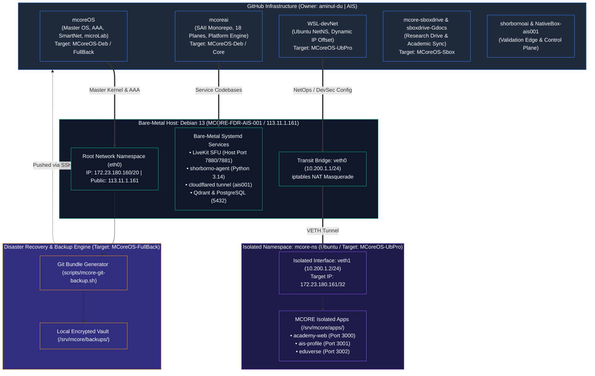
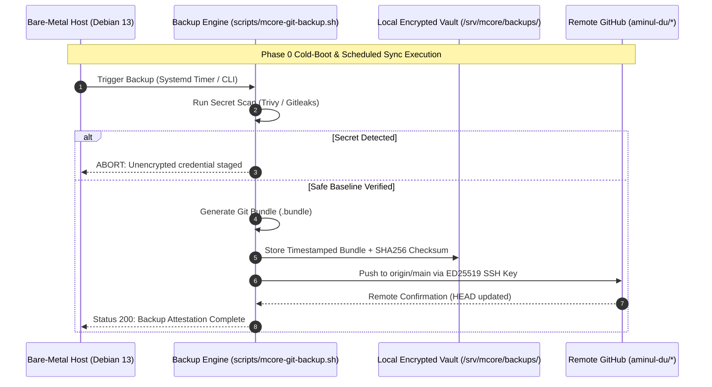

# MCOREOS GITHUB STRUCTURE & TOPOLOGY DIAGRAMS
**Document ID:** `DOC-MCOREOS-GH-DIAG-005`  
**Version:** `1.1.0`  
**Classification:** Sovereign Autonomous Intelligence Infrastructure (SAII 2050 Baseline)  
**Priority:** P0  
**Authority:** Aminul Islam Shamim (AIS) | `MCORE-FDR-AIS-001`  
**Date:** November 18, 2026  

---

## 1. System Ecosystem & Repository Hierarchy Diagram

The following Mermaid architectural diagram visualizes the unified relationship between the verified GitHub account `aminul-du`, the four target roles, and the physical bare-metal host execution layers:

---

## 2. Backup Pipeline Data Flow Diagram

---

## 3. Structural Analysis & Comparison Matrix

| Environment Tier | Primary Responsibility | Isolation Mechanism | Target Role Mapping | Resilience Level |
|---|---|---|---|---|
| **Debian 13 Root** | OS kernel, FreeRADIUS, LiveKit, Cloudflared | Bare-metal systemd unit boundaries | `MCoreOS-Deb` | High (Multi-process supervisor) |
| **Ubuntu `mcore-ns`** | Next.js micro-frontends, public edge applications | Linux Network Namespace (`iproute2`) | `MCoreOS-UbPro` | High (Zero host port conflict) |
| **Research Sandbox** | Academic data, experiment scripts, DU embeddings | Quarantined directories & separate git remotes | `MCoreOS-Sbox` | Isolated (No prod access) |
| **Central FullBack** | Disaster recovery ledgers, bundle archives | Offline Git bundle + SSH remote sync | `MCoreOS-FullBack` | Extreme (Lossless lineage) |

---

## 4. Cost, Risk, & Operational Trade-offs

| Strategy Choice | Cost | Trade-Off Advantage | Risk Factor | Strategic Mitigation |
|---|---|---|---|---|
| **Linux NetNS instead of Docker VM** | $0.00 | Instant startup (<10ms), zero memory overhead. | Requires root/sudo privileges for network setup. | Locked `/usr/local/bin/` wrapper script permissions. |
| **Native Git Bundles vs Cloud Snapshots** | $0.00 | Total cloud independence; portable across any machine. | Local NVMe disk failure could destroy local copy. | Bi-directional synchronization to remote GitHub repository. |
| **Direct SSH Keys vs Personal Access Tokens** | $0.00 | Immune to web phishing and token expiration churn. | Key exposure grants administrative push access. | Enforce passphrase encryption & file permissions `0600`. |
